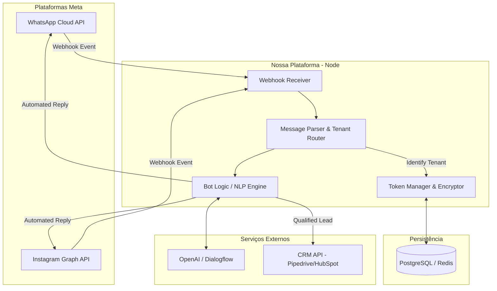
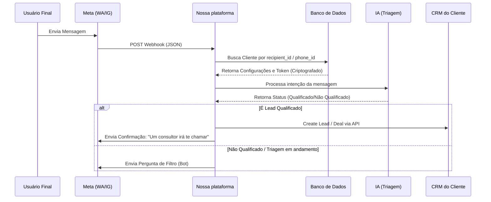
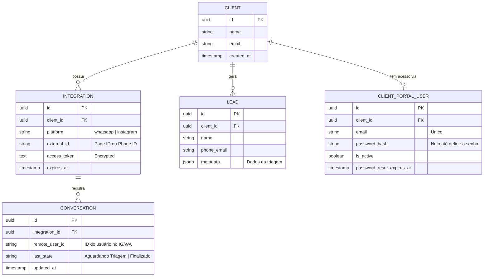

# Plataforma de respostas

Um dos grandes gargalos dos clientes que começam a fazer tráfego pago é a capacidade de responder o volume de mensagens recebidas devido ao aumento de interações que o tráfego pago gera. Pensando nisso, esta plataforma tem o objetivo de automatizar o contato inicial com estes clientes afim de captar e filtrar os clientes de acordo com sua intenção.

## Desenho técnico inicial

### Fluxo de API



### Fluxo de recebimento de mensagens



### Estrutura de dados:




## Autenticação e autorização

Toda rota protegida passa pelo `AuthGuard`, que aceita dois tipos de credencial:

- **Master API key** (`x-api-key`): credencial de máquina para máquina (integrações e jobs). Não tem usuário associado, então não é afetada pelas checagens de papel.
- **JWT** (`Authorization: Bearer <token>`): token emitido no login, usado pelo frontend.

### `scope` no JWT

O claim `scope` define para que um token serve:

- **Tokens de sessão normal** não têm `scope`. Funcionam em qualquer rota protegida pelo `AuthGuard`.
- **Tokens de propósito único** têm um `scope` que restringe o que podem fazer. Hoje o único é `media-upload` (token de curta duração emitido por `POST /auth/upload-token` para upload direto do navegador ao backend). O `AuthGuard` rejeita qualquer token com `scope`, então esses tokens não servem para outras rotas. O `scope: 'client-portal'` segue a mesma ideia: um token restrito às rotas do portal (ver [Portal do cliente](#portal-do-cliente)).

### Papel do usuário (`role`)

`UserEntity` tem o campo `role`, com os valores `admin` ou `member`. O papel é obrigatório ao criar uma conta (`POST /auth/users`).

Permissões atuais:

| Ação | `admin` | `member` |
| --- | --- | --- |
| Criar novas contas internas (`POST /auth/users`) | Sim | Não |
| Demais rotas protegidas pelo `AuthGuard` | Sim | Sim |

A checagem de papel é opt-in: só tem efeito em endpoints que usam `@Roles(...)` com o `RolesGuard`. Em endpoints sem esses dois, o papel é ignorado.

Para restringir um endpoint a certos papéis:

```ts
@UseGuards(AuthGuard, RolesGuard)
@Roles(UserRole.ADMIN)
@Post('exemplo')
exemplo() { ... }
```

O `RolesGuard` responde `403` quando o usuário autenticado não tem um dos papéis exigidos. Requisições autenticadas pela master API key não passam por essa checagem.

> ⚠️ O `RolesGuard` só é seguro quando executa **depois** de um guard (como o `AuthGuard`) que marque a requisição com `authMethod`/`user`; sem um usuário e sem esse marcador, ele nega por padrão. Nunca registre o `RolesGuard` como `APP_GUARD` global.


## Portal do cliente

O portal do cliente é a área onde um cliente externo (quem contrata o tráfego) acessa os próprios dados. Ele tem identidade e autenticação próprias, separadas da equipe interna.

### Identidades separadas: `ClientPortalUserEntity` x `UserEntity`

| | `UserEntity` (`users`) | `ClientPortalUserEntity` (`client_portal_users`) |
| --- | --- | --- |
| Quem é | Conta interna da equipe (admin ou member) | Cliente externo, vinculado a um `Client` |
| Vínculo | Nenhum cliente específico | Campo `clientId` obrigatório |
| Papel | `role` (`admin` / `member`) | Não tem papel; o acesso é limitado pelo `clientId` |
| Emitido por | `POST /auth/users` | `POST /auth/client-portal-users` (admin) |

As duas identidades nunca são a mesma linha nem a mesma tabela. Um token de cliente não representa um usuário interno, e um usuário interno não ganha acesso ao portal por esse caminho.

O e-mail é único em `client_portal_users`. A senha fica em `passwordHash` e nunca é serializada na resposta.

### Convite e redefinição de senha (Mailgun)

Não existe senha definida pelo admin. O fluxo é sempre por link enviado por e-mail:

1. **Convite**: o admin cria a conta com `POST /auth/client-portal-users` (ou reenvia com `POST /auth/client-portal-users/:id/resend-invite`). O backend gera um token aleatório, guarda apenas o hash SHA-256 e envia um e-mail com o link `${CLIENT_PORTAL_URL}/definir-senha?token=...`.
2. **Definir senha**: o cliente abre o link e envia o token com a nova senha para `POST /auth/client-reset-password`.
3. **Esqueci a senha**: `POST /auth/client-forgot-password` gera um novo token e envia o link `${CLIENT_PORTAL_URL}/redefinir-senha?token=...`. A resposta é sempre `204`, exista ou não a conta, e o envio do e-mail acontece em segundo plano para não revelar quais e-mails estão cadastrados.

Os tokens expiram em 1 hora (`CLIENT_PORTAL_RESET_TOKEN_TTL_MS`) e são de uso único: ao redefinir a senha, o hash e a data de expiração são limpos.

O envio usa o `MailService` com Mailgun. Variáveis de ambiente necessárias (ver `.env.example`): `MAILGUN_API_KEY`, `MAILGUN_DOMAIN`, `MAILGUN_FROM` e `CLIENT_PORTAL_URL`.

### Login e `scope: 'client-portal'`

`POST /auth/client-login` valida e-mail, senha e se a conta e o cliente estão ativos. Em caso de sucesso, emite um JWT com:

```json
{ "sub": "<id do ClientPortalUserEntity>", "clientId": "<id do cliente>", "scope": "client-portal" }
```

Esse token é de propósito restrito e tem dois guards que o tratam de forma diferente:

- **`AuthGuard`** (rotas internas) **rejeita** qualquer token com `scope`. Um token do portal não funciona nas rotas da equipe.
- **`ClientPortalAuthGuard`** (rotas do portal, como `GET /auth/client-portal/me` e `conversation-rules`) aceita a master API key, um JWT sem `scope` e um JWT com `scope: 'client-portal'`. Qualquer outro `scope` é rejeitado.

Um token do portal só alcança o que o `ClientPortalScopeGuard` permite: ele compara o `clientId` do token com o `clientId` da query ou do body e recusa acesso a outro cliente. Hoje o guard protege as rotas de `conversation-rules` que recebem `clientId` (criar, listar, editar e remover regras). O `GET /conversation-rules/posts` não usa o guard: para tokens do portal, o `clientId` vem sempre do próprio token e o parâmetro `pageId` é ignorado.

Para o detalhamento completo, ver:

- Frontend: `trafegoflow-client-portal` (repositório ainda não criado)
- Spec: [`docs/superpowers/specs/2026-10-27-client-portal-auto-reply-design.md`](docs/superpowers/specs/2026-10-27-client-portal-auto-reply-design.md)
