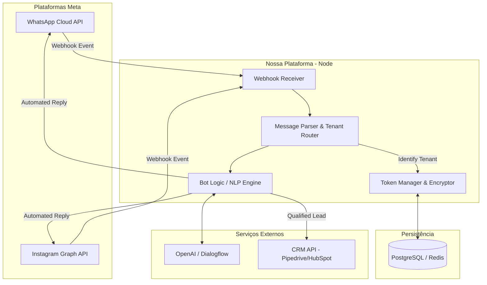
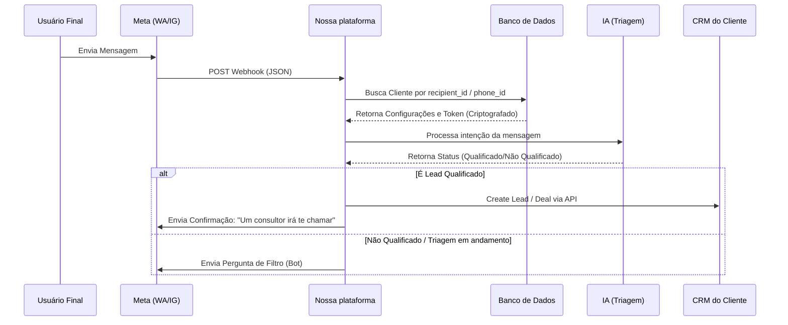
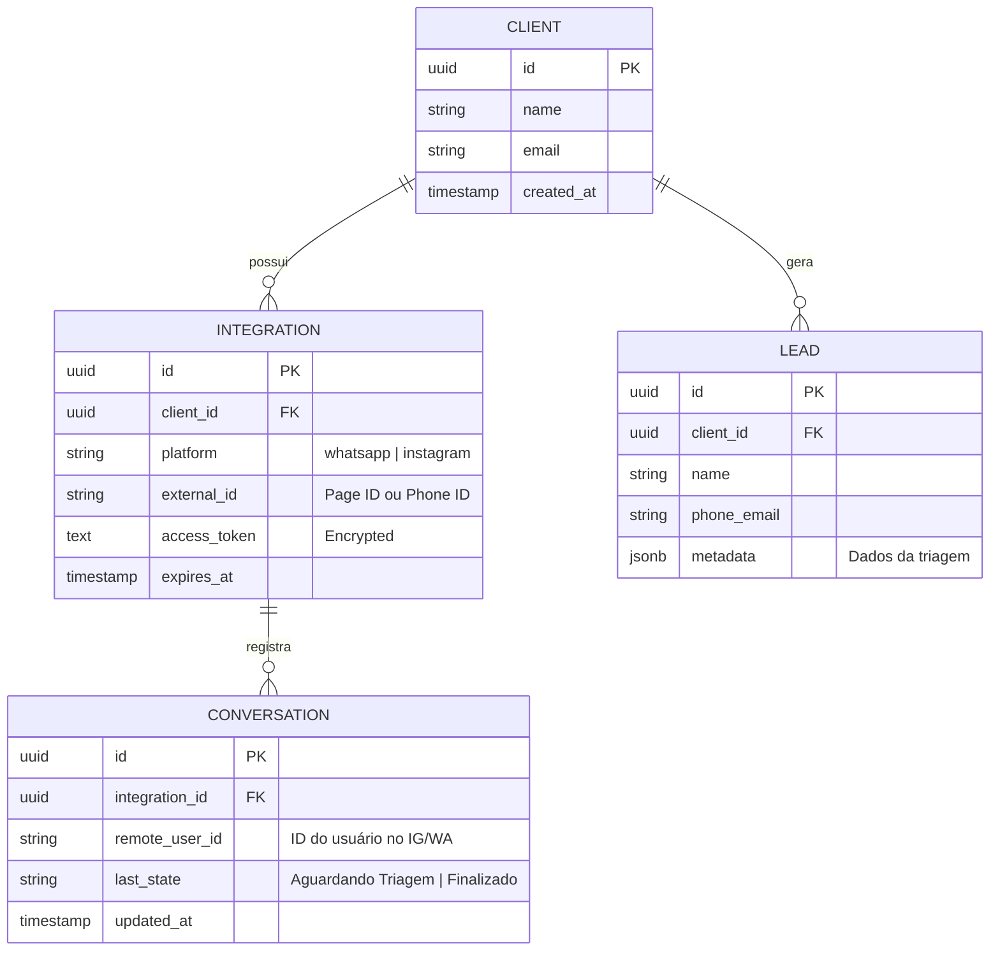

# Plataforma de respostas

Um dos grandes gargalos dos clientes que começam a fazer tráfego pago é a capacidade de responder o volume de mensagens recebidas devido ao aumento de interações que o tráfego pago gera. Pensando nisso, esta plataforma tem o objetivo de automatizar o contato inicial com estes clientes afim de captar e filtrar os clientes de acordo com sua intenção.

## Desenho técnico inicial

### Fluxo de API



### Fluxo de recebimento de mensagens



### Estrutura de dados:




## Autenticação e autorização

Toda rota protegida passa pelo `AuthGuard`, que aceita dois tipos de credencial:

- **Master API key** (`x-api-key`): credencial de máquina para máquina (integrações e jobs). Não tem usuário associado, então não é afetada pelas checagens de papel.
- **JWT** (`Authorization: Bearer <token>`): token emitido no login, usado pelo frontend.

### `scope` no JWT

O claim `scope` define para que um token serve:

- **Tokens de sessão normal** não têm `scope`. Funcionam em qualquer rota protegida pelo `AuthGuard`.
- **Tokens de propósito único** têm um `scope` que restringe o que podem fazer. Hoje o único é `media-upload` (token de curta duração emitido por `POST /auth/upload-token` para upload direto do navegador ao backend). O `AuthGuard` rejeita qualquer token com `scope`, então esses tokens não servem para outras rotas. O `scope: 'client-portal'`, previsto no plano de backend do portal do cliente, segue a mesma ideia: um token restrito às rotas do portal.

### Papel do usuário (`role`)

`UserEntity` tem o campo `role`, com os valores `admin` ou `member`. O papel é obrigatório ao criar uma conta (`POST /auth/users`).

Permissões atuais:

| Ação | `admin` | `member` |
| --- | --- | --- |
| Criar novas contas internas (`POST /auth/users`) | Sim | Não |
| Demais rotas protegidas pelo `AuthGuard` | Sim | Sim |

A checagem de papel é opt-in: só tem efeito em endpoints que usam `@Roles(...)` com o `RolesGuard`. Em endpoints sem esses dois, o papel é ignorado.

Para restringir um endpoint a certos papéis:

```ts
@UseGuards(AuthGuard, RolesGuard)
@Roles(UserRole.ADMIN)
@Post('exemplo')
exemplo() { ... }
```

O `RolesGuard` responde `403` quando o usuário autenticado não tem um dos papéis exigidos. Requisições autenticadas pela master API key não passam por essa checagem.

> ⚠️ O `RolesGuard` só é seguro quando executa **depois** de um guard (como o `AuthGuard`) que marque a requisição com `authMethod`/`user`; sem um usuário e sem esse marcador, ele nega por padrão. Nunca registre o `RolesGuard` como `APP_GUARD` global.
